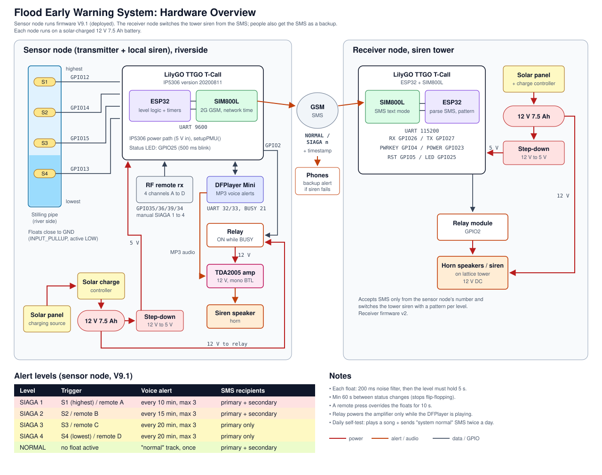
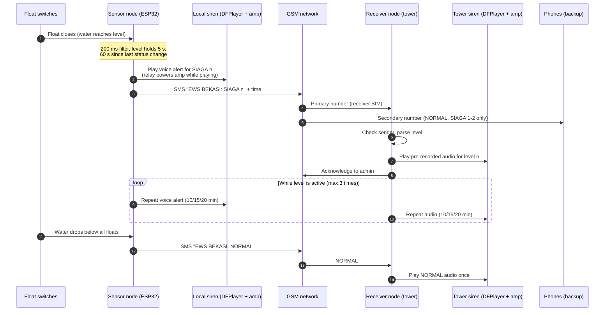

# Flood Early Warning System (ESP32 + GSM)

A low-cost, solar-powered flood early warning system for a riverside neighborhood in Bekasi, Indonesia. A sensor node at the river reads the water level with float switches, plays voice alerts through a local siren, and sends SMS alerts over 2G GSM. A receiver node on a siren tower turns those SMS messages into the same pre-recorded voice alerts for the wider area. Residents also receive the SMS as a backup in case a siren fails.

**Status:** sensor node deployed (firmware V9.1) and in active development since January 2026.



## How it works

1. **Sense.** Four float switches sit at different heights inside a stilling pipe at the river. Each one closes to ground when the water reaches it.
2. **Decide.** The ESP32 maps the highest active float to an alert level, from `SIAGA 4` (lowest float) to `SIAGA 1` (highest float, most severe). A level only counts after it holds for 5 s, and status changes are at least 60 s apart, so waves and debris do not cause false alarms.
3. **Alert locally.** A DFPlayer Mini plays a voice announcement for the level. A relay switches 12 V to the amplifier only while audio is playing, which saves battery.
4. **Alert remotely.** The SIM800L modem sends `NORMAL` or `SIAGA n` with a timestamp by SMS to the receiver node and to people's phones.
5. **Siren tower.** The receiver node accepts SMS only from the sensor node's number and plays the pre-recorded audio for that stage on its own DFPlayer, through an amplifier to the horn speakers.
6. **Self-test.** Twice a day the sensor node plays a song and sends a "system working normally" SMS, so the operators know it is still alive.

A 4-channel RF remote can also force any alert level by hand, for drills or when someone sees flooding first.

## Software flow



## Alert levels (sensor node V9.1)

| Level | Trigger | Voice alert repeat | SMS sent to |
|---|---|---|---|
| SIAGA 1 | S1 (highest float) or remote A | every 10 min, max 3 | primary + secondary |
| SIAGA 2 | S2 or remote B | every 15 min, max 3 | primary + secondary |
| SIAGA 3 | S3 or remote C | every 20 min, max 3 | primary only |
| SIAGA 4 | S4 (lowest float) or remote D | every 20 min, max 3 | primary only |
| NORMAL | no float active | "normal" track, once | primary + secondary |

*Siaga* means "alert" in Indonesian. Level 1 is the most severe, following the Indonesian convention.

The tower receiver (firmware v2) plays the same pre-recorded track for each stage and repeats it on the same schedule, so residents near the river and near the tower hear the same message.

## Hardware

Both nodes run from a 12 V 7.5 Ah battery charged by a solar panel through a solar charge controller. A step-down converter supplies 5 V to the board, and the same 12 V battery powers the amplifier and siren.

| Part | Sensor node | Receiver node |
|---|---|---|
| LilyGO TTGO T-Call (ESP32 + SIM800L, IP5306 version 20200811) | ✓ | ✓ |
| Float switches (x4) in a stilling pipe | ✓ | |
| DFPlayer Mini MP3 module + microSD card | ✓ | ✓ |
| TDA2005 bridged (BTL) mono amplifier module, 12 V | ✓ | ✓ |
| 4-channel RF remote receiver | ✓ | |
| Relay module | ✓ | ✓ |
| 12 V siren / horn speaker | ✓ | ✓ (on lattice tower) |
| 12 V 7.5 Ah battery, solar panel, solar charge controller | ✓ | ✓ |
| 12 V to 5 V step-down converter | ✓ | ✓ |

### Pin map

| Function | Sensor node | Receiver node |
|---|---|---|
| Float S1 / S2 / S3 / S4 | 12 / 14 / 15 / 13 (INPUT_PULLUP, active LOW) | |
| RF remote A / B / C / D | 35 / 36 / 39 / 34 | |
| DFPlayer RX / TX / BUSY | 32 / 33 / 21 | 32 / 33 / 21 |
| Relay (amplifier power) | 2 | 2 |
| Status LED | 25 | 25 |
| SIM800L | LilyGO `utilities.h` | LilyGO `utilities.h` |

## Repository layout

```
firmware/
  sensor-node/      V9.1, the firmware deployed at the river
  receiver-node/    receiver firmware v2 for the siren tower
  archive/          earlier versions (sensor v1, receiver v1)
docs/
  hardware-diagram.svg
```

## Setup

1. Install the ESP32 board package in the Arduino IDE and select **ESP32 Dev Module**.
2. Install the libraries **TinyGSM** and **DFRobotDFPlayerMini**.
3. Copy `utilities.h` from LilyGO's [T-Call SIM800 examples](https://github.com/Xinyuan-LilyGO/LilyGo-T-Call-SIM800) into each firmware folder.
4. In each firmware folder, copy `config.example.h` to `config.h` and fill in the phone numbers. `config.h` is git-ignored.
5. Put the MP3 files on each DFPlayer's microSD card: `0001` to `0004` for SIAGA 1 to 4 and `0005` for NORMAL (both nodes), plus `0006` and `0007` for the daily self-test songs (sensor node).
6. **The tower receiver's SIM is always the sensor node's primary number** (`PRIMARY_NUMBER`). The secondary number is a person's phone for backup alerts; it never receives SIAGA 3, SIAGA 4, or the daily self-test.

## Known issues

- **Daily self-test hours.** The comments say 10:00 and 20:00, but the code checks hours 6 and 22. This may be a time-zone offset from the network clock; it needs checking on the device.
- **`S4_INTERVAL` is unused.** SIAGA 4 reuses the SIAGA 3 interval. Both are 20 min, so behaviour is the same today.
- **Blocking time queries.** `getTimestamp()` sends an AT command every 2 s for debug output, which slows the main loop.

## Roadmap

- Log water-level events to a cloud database and dashboard for flood history.
- Replace float switches with a continuous level sensor (ultrasonic or pressure) for finer readings and rate-of-rise alerts.
- Move to a 4G modem.

## Credits

Electronics, water-level sensing, and firmware by [Balkan Assakandari](https://github.com/balkan16). The stilling pipe at the river and the siren on the tower were installed by the local community team.
